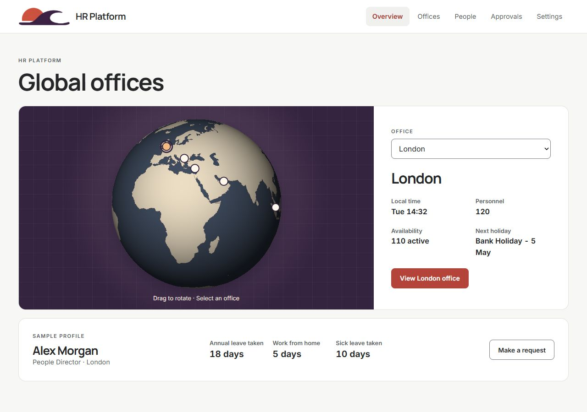
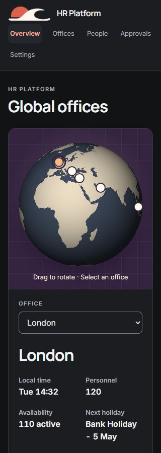

# HR Platform

Explore a sample workforce across an interactive globe. Drag to rotate the globe, or choose an office from the list to open its staffing summary. The app also includes a sortable people directory, an expandable org chart and a sample leave request form.

[Open HR Platform](https://imchuwy.github.io/app-hr-platform/)

Mobile view in the dark theme

## Run locally

Serve the repository root with a static web server, for example **python -m http.server 8000**, and open <http://localhost:8000>. The app uses fictional personnel and sample office snapshots. Completing the sample form displays a local confirmation.

Globe coastlines use [Natural Earth data](https://www.naturalearthdata.com/about/terms-of-use/).
